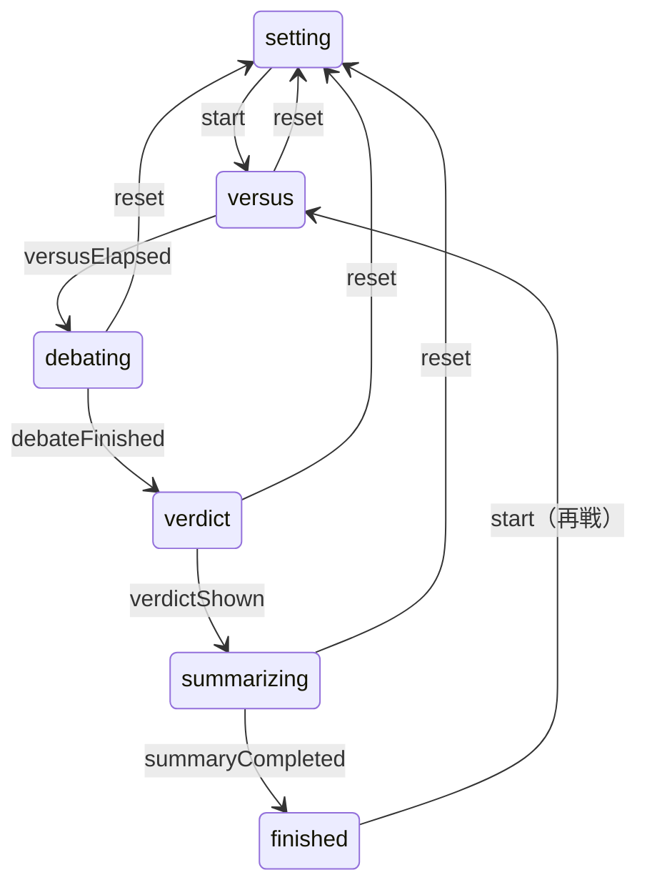

# 状態管理のステートマシン設計

## 結論

現行の `DebateController` は `BattlePhase` という列挙こそあるが、実態は「フェーズを直接代入する手続きコード」であり、ステートマシンとは呼べない。明示的な遷移表を持つ純粋なマシン `BattleMachine` を分離し、コントローラはイベントをディスパッチするだけにする。これにより (1) 不正な遷移が型と表で排除され、(2) 遷移ロジックが単体テスト可能になり、(3) 進行中バトルのキャンセルが正しく実装できる。

## 現行コードの問題（実測）

1. **遷移が無検証**：`phase = BattlePhase.xxx` の直接代入が5箇所に散在し、どの状態からどの状態へ移ってよいかはどこにも書かれていない。
2. **開始の再入ガードが遅い**：`startBattle` の `_running` チェックは versus 演出の待機と開始メッセージ追加の「後」にある。二重起動すると状態が壊れてから止まる。
3. **キャンセル不能（実バグ）**：対戦中に `resetToSetting()` を呼んでも実行中ループは止まらず、メッセージを追加し続け、最後に phase を `finished` に上書きする。画面を戻っても裏でバトルが完走する。
4. **直交フラグの無法地帯**：`paused` / `speed` / `_verdictRequested` / `typingDebater` がフェーズと無関係に読み書きでき、「finished で pause」のような意味のない状態を表現できてしまう。
5. **ガード条件の重複**：「判定を促せるのは4ターン以降」という規則が Controller と BattleScreen の両方に書かれている。

## 設計

### 主マシン（フェーズ遷移）

遷移表にない (状態, イベント) の組は**不正遷移として拒否**する（デバッグ時にログ、状態は変更しない）。

| 現在の状態 | start | versusElapsed | debateFinished | verdictShown | summaryCompleted | reset |
|---|---|---|---|---|---|---|
| setting | versus | - | - | - | - | setting |
| versus | - | debating | - | - | - | setting |
| debating | - | - | verdict | - | - | setting |
| verdict | - | - | - | summarizing | - | setting |
| summarizing | - | - | - | - | finished | setting |
| finished | versus | - | - | - | - | setting |

### 直交領域（XStateでいう parallel state）

再生状態はフェーズと直交するため、主マシンに混ぜず独立した小マシンにする。

- `PlaybackMachine`: playing ⇄ paused。ただし**遷移できるのは phase == debating のときだけ**（ガード）。
- `speed` は状態ではなく拡張状態（context）として扱う。状態にすると 1x/2x の分だけ状態が倍化するため。
- 「判定を促す」は状態遷移ではなく debating 内のフラグ。ただし有効条件はマシンのガード関数 `canRequestVerdict(phase, turnIndex)` に一元化し、画面側はそれを参照するだけにする。

### ガード（一元化する条件）

- `canRequestVerdict`: phase == debating かつ turnIndex >= 4
- `shouldEarlyFinish`: turnIndex >= 6 かつ |momentum - 50| >= 30

### 副作用の分離

マシンは純粋関数のみ（遷移先を返す／拒否する）。タイマー待機とエンジン呼び出しはコントローラ側の責務に残すが、その実行は世代トークンで守る：

- バトル開始ごとに `generation` をインクリメントし、ループは各 await の後に「自分の世代が現行か＋phase が期待どおりか」を確認する。不一致なら静かに終了する。
- `cancelCurrentBattle()` は generation を進めて reset イベントをディスパッチする。これにより問題3（キャンセル不能）が構造的に解消する。
- `startBattle` は最初の await より前に start イベントをディスパッチする。二重起動は versus 中の start が不正遷移として即座に拒否される（問題2の解消）。

## 採用しなかった選択肢

- **bloc / flutter_bloc の導入**：イベント駆動の考え方は同じだが、この規模（状態6・画面3）では依存と定型コードが見合わない。将来、画面やイベントが増えたら移行先の第一候補。
- **state_machine パッケージ等の汎用FSMライブラリ**：遷移表そのものは50行程度で書け、外部依存を増やす理由が薄い。
- **状態を sealed class 化しデータを持たせる**（Idle{config} / Debating{messages,...} のように）：型安全性は上がるが、画面側の参照コード全面改修が要る。今回はコントローラの公開API（phase / messages / momentum 等）を維持し、マシンだけを差し替える段階に留めた。次の改修候補。

## テスト方針

- 遷移表の全組をテストする（許可遷移・不正遷移・reset の全状態網羅）。
- ガード関数の境界値（turnIndex 3/4、6、勢い差 29/30）。
- 統合：フェイク時間でバトル完走、対戦中キャンセル後に状態が進まないこと、二重起動が拒否されること。
